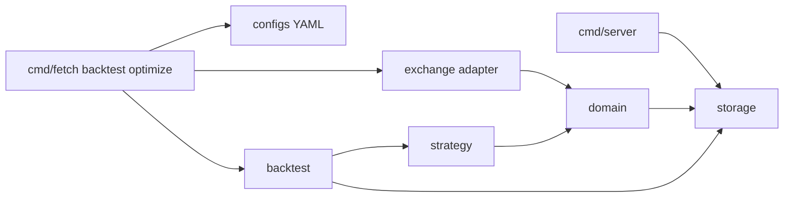

# Архитектура

## Слои (Clean Architecture)

```
┌─────────────────────────────────────────┐
│  cmd/          CLI + HTTP entrypoints   │
├─────────────────────────────────────────┤
│  internal/server   HTTP handlers      │
├─────────────────────────────────────────┤
│  internal/backtest  internal/optimize   │  ← use cases
│  internal/strategy  internal/indicator  │
├─────────────────────────────────────────┤
│  internal/exchange  internal/storage    │  ← adapters
│  internal/config                        │
├─────────────────────────────────────────┤
│  internal/domain                        │  ← entities
└─────────────────────────────────────────┘
```

**Правило зависимостей:** внутренние слои не знают о HTTP/CLI. `domain` не импортирует ничего из проекта.

## Паттерны проектирования

| Паттерн | Где | Зачем |
|---------|-----|-------|
| **Strategy** | `internal/strategy` | Каждая торговая стратегия — отдельная реализация интерфейса |
| **Repository** | `internal/storage` | Абстракция над Parquet / SQLite / Postgres |
| **Adapter** | `internal/exchange` | Единый интерфейс для Binance, Bybit |
| **Factory** | `internal/strategy/registry` | Создание стратегии по имени из YAML |
| **Builder** | `internal/backtest` | Сборка backtest run из конфига |
| **Parser/Interpreter** | `internal/strategyparser` | Извлечение параметров из Pine-скриптов (`input.*`) |
| **Observer** | WebSocket (Sprint 7) | Подписка на live-свечи |

## SOLID в проекте

### Single Responsibility
- `exchange/binance` — только API биржи
- `storage/parquet` — только чтение/запись свечей
- `config` — только загрузка YAML

### Open/Closed
- Новая стратегия = новый файл + регистрация, без изменения backtester
- Новая биржа = новый adapter, без изменения fetcher CLI

### Liskov Substitution
- Любой `storage.CandleRepository` работает с fetcher и backtester

### Interface Segregation
- `exchange.MarketDataProvider` — только получение свечей
- `storage.ResultRepository` — только результаты прогонов

### Dependency Inversion
- Backtester зависит от `strategy.Strategy`, не от конкретной EMA

## Поток данных

```
Binance API
    → exchange.FetchKlines()
    → domain.Bar[]
    → storage.ParquetWriter
    → data/binance/BTCUSDT/1h.parquet

configs/runs/*.yaml
    → config.LoadRun()
    → backtest.Run()
    → storage.SQLite (results)
    → server UI (просмотр)
```

## Диаграмма компонентов



## Расширяемость

Добавить новую стратегию:
1. Создать `internal/strategy/my_strategy.go`
2. Реализовать `strategy.Strategy`
3. Зарегистрировать в `registry.go`
4. Добавить `configs/strategies/my_strategy.yaml`

Добавить Pine-стратегию (`.txt`):
1. Положить файл в `strategies/*.txt`
2. Запустить `make parse-mat` (или `cmd/parse-strategy`)
3. Проверить сгенерированный YAML и скорректировать диапазоны optimize
4. Создать `configs/runs/*` для целевых монет/таймфреймов

Добавить монету:
1. Добавить символ в `configs/pools/major.yaml`
2. `make fetch SYMBOL=SOLUSDT TF=1h`
